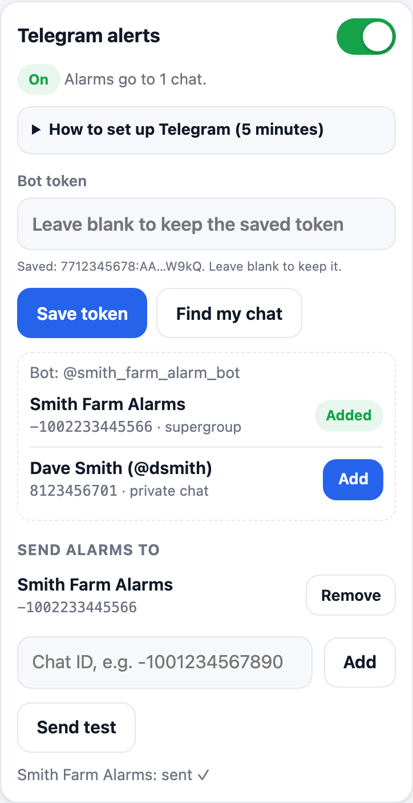

# PLC Command Center

A small, self-hosted **PLC monitoring dashboard and alarm notifier** that runs on a Mac mini.
It polls your PLCs read-only, keeps history and trend charts, and sends alarms to an **iMessage
group** and/or **Telegram**. Anyone in the iMessage group can acknowledge an alarm just by replying.

Built for farm and small-plant use (pumps, tanks, wells, generators) where a full SCADA system is overkill.

<p align="center"></p>

## Features

- **Multi-PLC drivers, read-only.** No driver has a write method.
  - Allen-Bradley SLC 500 / MicroLogix (PCCC over EtherNet/IP) and ControlLogix / CompactLogix (symbolic tags), via [pycomm3](https://github.com/ottowayi/pycomm3)
  - Modbus TCP (holding/input registers, coils, discrete inputs, word swap), via [pymodbus](https://github.com/pymodbus-dev/pymodbus)
  - Siemens S7-300/1200/1500 (`DBn.REAL/INT/DINT/WORD`, bits), via [python-snap7](https://github.com/gijzelaerr/python-snap7)
  - OPC UA (NodeIds, optional username/password and security policy), via [asyncua](https://github.com/FreeOpcUa/opcua-asyncio)
  - MQTT (topic plus optional JSON path, TLS, offline detection), via [paho-mqtt](https://github.com/eclipse/paho.mqtt.python)
- **Mobile-first dashboard** (Flask + waitress). It has light and dark mode and can be added to the iPhone home screen (PWA icon).
  - **Overview** you can customize: value boxes or live chart cards for any tag, in any order.
  - **Trends**: any tag with an optional second axis, 1 h to 60 days or a custom range, pinch-zoom, and limit lines.
  - **Devices**: add and edit PLCs and tags in the browser (password protected).
  - **Settings**: iMessage alarm group (with Check and Send test), **Telegram setup** (paste the bot token, *Find my chat*, *Send test*), per-tag alarm switches, an alert log with delivery status, and uptime.
- **Alarms**
  - Low/high limits per tag, with a one-time alert and a CLEAR message when the value returns.
  - Optional escalating alarm (Alarm, then Escalation, then Final warning) that stops when acknowledged.
  - COMM LOSS / RECOVERY alerts when a device stops or starts answering.
  - **iMessage** (via Messages.app) and **Telegram** (Bot API, one or more chats). Duplicate texts are suppressed.
  - **Acknowledge** by replying in the iMessage group or with the dashboard button.
- **Two launchd services**: the poller/alerter and the dashboard. A dashboard crash never stops alarms.
- **SQLite storage** with automatic retention. No cloud account is needed.

## Quick start

On a Mac mini with macOS 13 or newer, open Terminal and run:

```
curl -fsSL https://raw.githubusercontent.com/gmaendel/PLCCommandCenter/main/install.sh | bash
```

The installer is safe to re-run, and re-running it is also how you update. It takes care of:
- Apple's Command Line Tools (Python 3.9+ and git) and the Python packages; Homebrew is not needed.
- The dashboard password.
- The two background services.
- Optional never-sleep and auto-restart power settings.
- A guided Full Disk Access step (so iMessage replies can acknowledge alarms) that it then verifies.
- Opening Messages and the dashboard at the end.

Then add your PLCs under **Devices** at `http://<mac-ip>:8085`.

From a cloned or unzipped copy, run `./install.sh` instead. `./install.sh --help` lists the options:
`--dir`, `--port`, `--yes` with `--password-file`, `--no-power`, `--dry-run` and `--uninstall`.

**The full step-by-step guide is in [docs/SETUP.md](docs/SETUP.md).** It covers the iMessage group,
Telegram setup, adding each PLC type, the dashboard password and the home-screen icon. It is written
for non-programmers.

## How it works

```
app/plccc_poller.py   poller/alerter service (launchd: com.plccommandcenter.poller)
app/plccc_web.py      dashboard service      (launchd: com.plccommandcenter.web, port 8085)
app/plccc/
  drivers.py   one read-only driver per PLC family + address parsers, decoders, scaling
  alarms.py    threshold / escalating / comm-loss state machines (injected clock, fully unit-tested)
  alerts.py    Alerter (Telegram + iMessage worker threads, de-dup, alert log) and AckChecker (chat.db replies)
  telegram.py  Telegram Bot API helpers and the live Telegram config (Settings page, .env fallback)
  poller.py    supervisor + one worker thread per device; picks up device/tag edits without a restart
  web.py       Flask app + JSON API; templates/ and static/ (Chart.js etc. vendored, works offline)
  db.py        SQLite connection + additive migrations
install.sh     one-step installer/updater (Command Line Tools, venv, services, permissions guide)
scripts/       install.sh (venv + services), uninstall.sh, export_data.sh (backup), dryrun_smoke.sh, ...
launchd/       plist templates rendered by scripts/install.sh (label prefix PLCCC_LABEL_PREFIX)
```

The poller runs under the Command Line Tools **Python.app** binary, with the venv's packages on
`PYTHONPATH`, so that a single Full Disk Access grant lets it read `~/Library/Messages/chat.db` for
acknowledgements. iMessages are sent with AppleScript (`osascript`). Telegram alerts go straight to the
Bot API over HTTPS; nothing reads Telegram replies.

`app/pump_monitor.py`, `modbus_monitor.py`, `siemens_monitor.py`, `ab_monitor.py` and `pump_web.py`
are the original single-purpose v1 scripts. They are kept so `tests/test_v1_equivalence.py` can run
them side by side with v2. `scripts/rollback.sh` and `scripts/install.sh --replace` exist only for migrating an
old v1 install; a new install never needs them.

## Configuration

Most settings are made on the dashboard (devices, tags, limits, iMessage group, Telegram). `.env`
(created by the installer, `chmod 600`, gitignored) holds:

| Key | Purpose |
|---|---|
| `DASHBOARD_PASSWORD` | Required to change anything on the dashboard (20 wrong tries in 10 min locks the IP out) |
| `TELEGRAM_BOT_TOKEN`, `TELEGRAM_CHAT_ID` | Optional fallback when the Telegram card has nothing saved (comma-separated chat ids allowed) |
| `PLCCC_IMESSAGE_CHAT` | Default iMessage group name (`PLC Alarms`) |
| `DASHBOARD_HOST` / `DASHBOARD_PORT` | Default `0.0.0.0:8085` |
| `PLCCC_POLL_INTERVAL` | Seconds between polls (default 60) |
| `PLCCC_DRY_RUN=1` | Log alerts instead of sending them (testing only) |

See `.env.example` for the rest. Logs are in `logs/`, data in `data/pump_data.db`, and backups go to
`backups/` via `scripts/export_data.sh`.

> The dashboard is meant for your local network. To reach it from outside, use a VPN such as Tailscale
> rather than forwarding port 8085.

## Development

```
PYTHONPATH=app:. venv/bin/python -m unittest discover -s tests -t .    # temp DB, dry-run, Telegram mocked
PLCCC_DRY_RUN=1 PLCCC_DB_PATH=/tmp/copy.db venv/bin/python app/plccc_web.py --port 18085   # dashboard on a copy
scripts/dryrun_smoke.sh 300        # poll real PLCs read-only in dry-run on a fresh copy of the DB
```

## License

[MIT](LICENSE) © 2026 Greg Maendel
